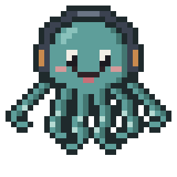
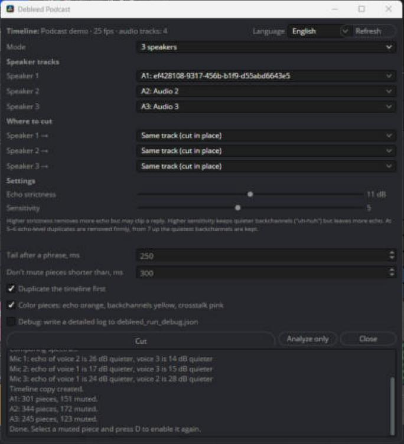
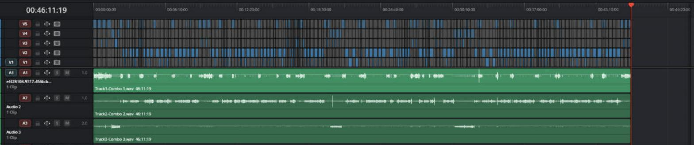
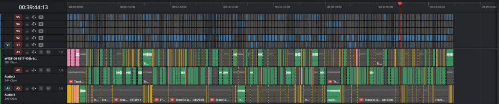
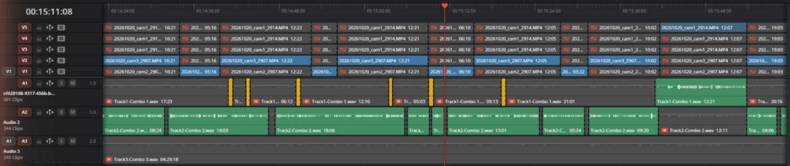

<p align="center">
  
</p>

<h1 align="center">Debleed Podcast</h1>

<p align="center"><b>Removes mic bleed from multi-mic podcast recordings in DaVinci Resolve Studio.</b><br>
Free script by <a href="https://visualharmony.pro">Visual Harmony Production</a></p>

<p align="center"><a href="README.ru.md">Русская версия</a></p>

When two or three people record a podcast, every microphone also picks up the other people at a lower level.
On each track you hear the neighbour as a faint echo. Usually you fix it by hand: find every piece where a
track only carries someone else's voice and disable it. Debleed Podcast does that for you.

It cuts each speaker's clip on the timeline into pieces and disables the pieces with echo only.
Nothing is rendered or exported: the clips still point to your original files, and any disabled piece can be
turned back on with the **D** key.



**Before**: one long clip per speaker, every track carries the others' echo.



**After**: each track is cut, the echo pieces are muted.



## Requirements

| | |
|---|---|
| **DaVinci Resolve Studio** | Required. Tested on **DaVinci Resolve Studio 21** (Windows). The free version of Resolve won't work: since 19.1 Blackmagic disabled script windows (UIManager) in the free edition. |
| **Python 3, 64-bit** | Resolve runs scripts with the Python installed on your computer. Tested with Python 3.13. Get it from [python.org](https://www.python.org/downloads/). |
| **numpy** and **soundfile** | **Required libraries.** The script will not run without them. Install them into the same Python that Resolve uses (see below). |

macOS should work the same way, but it hasn't been tested yet.

## Installation

1. **Install the libraries** (once):

   ```
   pip install -r requirements.txt
   ```

   or directly:

   ```
   pip install numpy soundfile
   ```

   If you have several Python versions, make sure you install into the one Resolve uses.
   You can check it in Resolve: **Workspace → Console → Py3**, then type
   `import sys; print(sys.executable, sys.prefix)`.

2. **Copy `Debleed Podcast.py`** into the Resolve scripts folder:

   - Windows: `%APPDATA%\Blackmagic Design\DaVinci Resolve\Support\Fusion\Scripts\Utility\`
   - macOS: `~/Library/Application Support/Blackmagic Design/DaVinci Resolve/Fusion/Scripts/Utility/`

3. Restart Resolve. The script appears in **Workspace → Scripts → Debleed Podcast**.

## How to use

1. Sync the speaker tracks on the timeline first. The script works best right after syncing,
   when each speaker has one long clip on their own audio track.
2. Open **Workspace → Scripts → Debleed Podcast**.
3. Choose the **mode**: 2 or 3 speakers.
4. Pick the audio track of each speaker.
5. Choose **where to cut** for each speaker:
   - *Same track*: the clip is cut in place;
   - *New track*: pieces go to a new track, the original track is muted;
   - or any existing track.
6. Press **Cut**. A 45-minute recording with three people takes about 3–4 minutes, Resolve doesn't respond while it runs.

**Analyze only** runs the analysis without changing anything on the timeline.

### Colors on the timeline



*About 1.5 minutes after cutting: speaker 2 talks (green), speaker 1 only adds short replies (yellow), the echo on tracks 1 and 3 is muted (grey).*

| Color | Meaning |
|---|---|
| grey (disabled) | echo of another speaker, the piece is muted. Resolve draws disabled clips grey, so their orange color isn't visible |
| green | the speaker's own voice |
| yellow | a short reply over someone else's speech ("uh-huh", "yeah") |
| pink | a longer piece where people talk at the same time |

Colors can be turned off with the *Color pieces* checkbox.

### Settings

| Setting | What it does |
|---|---|
| **Echo strictness** (default 11 dB) | How much louder than the expected echo a sound must be to count as the speaker's own voice. Higher removes more echo, but may clip a quiet reply. |
| **Sensitivity** (default 5) | Higher keeps quieter backchannels but leaves more echo. At 5–6 duplicates at echo level are removed firmly; from 7 up the quietest "uh-huh" are kept. |
| **Tail after a phrase** (250 ms) | How long a track stays open after the speaker stops, so word endings and breath aren't cut. |
| **Don't mute pieces shorter than** (300 ms) | Short gaps inside a phrase stay on, so the track doesn't flicker. |
| **Duplicate the timeline first** | Makes a copy of the timeline before cutting. On by default. |
| **Debug** | Writes a detailed log to `debleed_run_debug.json` (Windows: `%APPDATA%\DebleedPodcast`, macOS: `~/Library/Application Support/DebleedPodcast`). |

You can change the settings and press **Cut** again on the same timeline: the script joins its previous
pieces back into one clip and cuts again.

### Interface languages

English, Español, Русский, Português, Français, Deutsch, 中文, 日本語, हिन्दी, العربية.
Pick one in the top-right corner of the window; the choice is remembered.

## How it works

The echo of voice A on microphone B is a copy of voice A filtered by the room. So its spectrum can be
predicted from track A. For every 10 ms the script compares the tracks and keeps a piece on track B only
if B has sound that voice A and room noise can't explain: a different pitch, different formants.
This is how it can tell a quiet "uh-huh" from echo even when both are equally loud.

The echo level is estimated for every minute of the recording separately, so people moving in their
chairs don't break the result.

## Limitations

- Each speaker should have their own microphone and their own audio track.
- Clips on the speaker tracks must overlap in time (a synced recording).
- A very quiet "uh-huh" at exactly the echo level can be muted at the default sensitivity.
  Move *Sensitivity* to 7 or higher if such replies matter more than leftover echo.
- Only the clips that come from the same file as the longest clip on a track are processed; other clips
  on the track are left alone.

## Troubleshooting

| Problem | Fix |
|---|---|
| The log says a library is missing | Install `numpy` and `soundfile` into the Python that Resolve uses, then restart Resolve. |
| The window doesn't open | Check that you run DaVinci Resolve **Studio**. Script windows don't work in the free version. |
| "Resolve placed a piece in the wrong spot" | Nothing is lost: the script puts the original clip back. Check that the track isn't locked. Send the debug log in an issue. |
| You want to undo everything | Open the timeline copy "… before Debleed …" in the Media Pool, or press Ctrl+Z. |
| The window still behaves like an old version | Close the window and run the script from the menu again: an open window keeps running the code it was started with. |

## Made by Visual Harmony Production

<a href="https://visualharmony.pro">
  <picture>
    <source media="(prefers-color-scheme: dark)" srcset="docs/images/visual-harmony-wide-dark.png">
    
  </picture>
</a>

Debleed Podcast was made at **Visual Harmony Production**, a video and podcast production in Barcelona.
We record and edit podcasts, YouTube shows, Reels and events, and use tools like this one in our own work.

- Website: [visualharmony.pro](https://visualharmony.pro)
- Instagram: [@visualharmony.pro](https://instagram.com/visualharmony.pro)

If the script saved you some editing time, a star on GitHub or a tag on Instagram is the best thank-you.

## License

[MIT](LICENSE): free to use, change and share, including commercial use.
