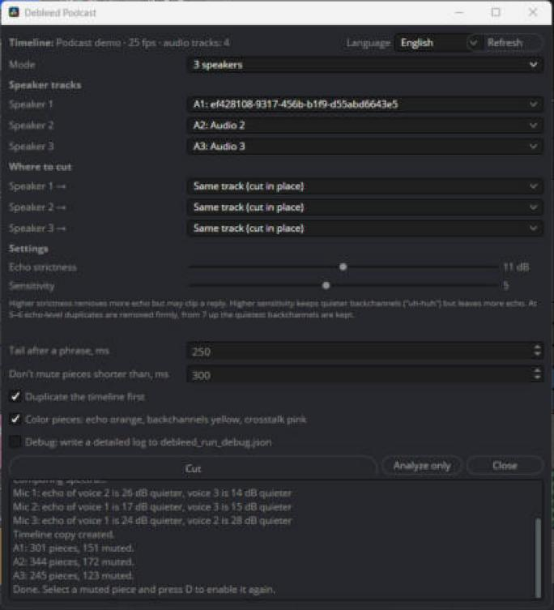
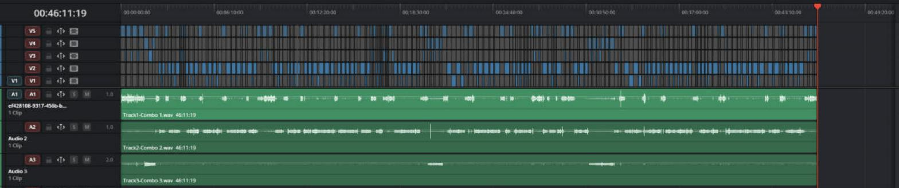
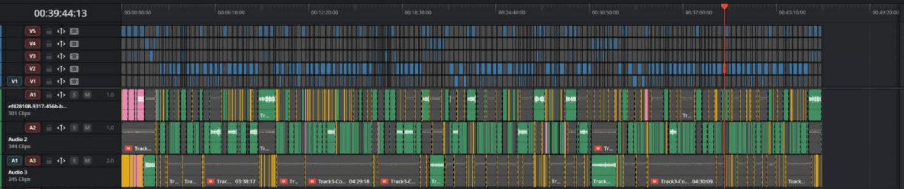
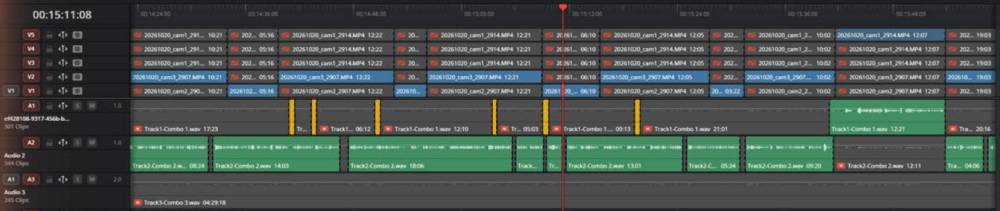

<p align="center">
  
</p>

<h1 align="center">Debleed Podcast</h1>

<p align="center"><b>Убирает эхо соседа на дорожках подкаста в DaVinci Resolve Studio.</b><br>
Бесплатный скрипт от <a href="https://visualharmony.pro">Visual Harmony Production</a></p>

<p align="center"><a href="README.md">English version</a></p>

Когда подкаст пишут двое или трое и у каждого свой микрофон, каждый микрофон слышит и остальных, только тише.
На дорожке получается фоновое эхо собеседника. Обычно его чистят руками: ищут куски, где на дорожке звучит
только чужой голос, и выключают их. Debleed Podcast делает это сам.

Скрипт режет клип каждого спикера на таймлайне на куски и выключает те, где на дорожке только эхо.
Ничего не рендерится и не экспортируется: клипы ссылаются на твои исходные файлы, а любой выключенный кусок
включается обратно клавишей **D**.



**До**: у каждого спикера один длинный клип, на каждой дорожке слышно эхо остальных.



**После**: дорожки нарезаны, куски с эхом выключены.



## Что нужно

| | |
|---|---|
| **DaVinci Resolve Studio** | Обязательно. Проверено на **DaVinci Resolve Studio 21** (Windows). В бесплатной версии Resolve скрипт не заработает: с версии 19.1 Blackmagic отключила в ней окна скриптов (UIManager). |
| **Python 3, 64-битный** | Resolve запускает скрипты через Python, установленный на компьютере. Проверено на Python 3.13. Скачать можно на [python.org](https://www.python.org/downloads/). |
| **numpy** и **soundfile** | **Обязательные библиотеки.** Без них скрипт не запустится. Ставить нужно в тот же Python, которым пользуется Resolve (как это сделать, ниже). |

На macOS должно работать так же, но пока там не проверялось.

## Установка

1. **Поставь библиотеки** (один раз):

   ```
   pip install -r requirements.txt
   ```

   или напрямую:

   ```
   pip install numpy soundfile
   ```

   Если на компьютере несколько версий Python, ставь в ту, которую видит Resolve. Проверить можно в самом
   Resolve: **Workspace → Console → Py3**, затем ввести `import sys; print(sys.executable, sys.prefix)`.

2. **Скопируй `Debleed Podcast.py`** в папку скриптов Resolve:

   - Windows: `%APPDATA%\Blackmagic Design\DaVinci Resolve\Support\Fusion\Scripts\Utility\`
   - macOS: `~/Library/Application Support/Blackmagic Design/DaVinci Resolve/Fusion/Scripts/Utility/`

3. Перезапусти Resolve. Скрипт появится в меню **Workspace → Scripts → Debleed Podcast**.

## Как пользоваться

1. Сначала синхронизируй дорожки спикеров на таймлайне. Лучше всего запускать скрипт сразу после синхронизации,
   пока у каждого спикера один длинный клип на своей аудиодорожке.
2. Открой **Workspace → Scripts → Debleed Podcast**.
3. Выбери **режим**: 2 или 3 спикера.
4. Укажи аудиодорожку каждого спикера.
5. Выбери, **где резать**, отдельно для каждого:
   - *Та же дорожка*: клип режется на месте;
   - *Новая дорожка*: куски кладутся на новую дорожку, исходная выключается;
   - или любая из существующих дорожек.
6. Нажми **Нарезать**. Запись на 45 минут с тремя спикерами обрабатывается минуты 3–4, Resolve в это время
   не откликается.

Кнопка **Только анализ** считает всё то же самое, но ничего не меняет на таймлайне.

### Цвета на таймлайне



*Полторы минуты после нарезки: говорит второй спикер (зелёный), первый только коротко отвечает (жёлтый), эхо на первой и третьей дорожках выключено (серый).*

| Цвет | Что значит |
|---|---|
| серый (выключен) | эхо другого спикера, кусок выключен. Resolve рисует выключенные клипы серыми, поэтому их оранжевый цвет не виден |
| зелёный | свой голос спикера |
| жёлтый | короткая реплика поверх чужой речи («ага», «угу») |
| розовый | длинный кусок, где говорят одновременно |

Раскраску можно отключить галочкой *Красить куски*.

### Настройки

| Настройка | Что делает |
|---|---|
| **Строгость к эху** (по умолчанию 11 дБ) | Насколько звук должен быть громче ожидаемого эха, чтобы считаться своим голосом. Больше: уходит больше эха, но может срезаться тихая реплика. |
| **Чувствительность** (по умолчанию 5) | Больше: сохраняются более тихие «ага», но остаётся больше эха. На 5–6 дубляж на уровне эха убирается жёстко, с 7 и выше сохраняются самые тихие «ага». |
| **Запас после фразы** (250 мс) | Сколько дорожка остаётся включённой после того, как человек замолчал, чтобы не обрезать окончания слов и вдох. |
| **Не выключать куски короче** (300 мс) | Короткие паузы внутри фразы остаются включёнными, дорожка не мигает. |
| **Сначала сделать копию таймлайна** | Перед нарезкой делает копию таймлайна. Включено по умолчанию. |
| **Отладка** | Пишет подробный лог в `debleed_run_debug.json` (Windows: `%APPDATA%\DebleedPodcast`, macOS: `~/Library/Application Support/DebleedPodcast`). |

Настройки можно поменять и снова нажать **Нарезать** на том же таймлайне: скрипт соберёт свою прошлую нарезку
обратно в целый клип и порежет заново.

### Языки интерфейса

English, Español, Русский, Português, Français, Deutsch, 中文, 日本語, हिन्दी, العربية.
Язык выбирается в правом верхнем углу окна и запоминается.

## Как это работает

Эхо голоса A в микрофоне B повторяет голос A, только окрашенный комнатой. Поэтому его спектр можно предсказать
по дорожке A. Каждые 10 мс скрипт сравнивает дорожки и оставляет кусок на дорожке B, только если в нём есть звук,
который голосом A и шумом комнаты не объяснить: другая высота голоса, другие форманты. Так тихое «ага» отличается
от эха, даже когда по громкости они одинаковые.

Силу эха скрипт оценивает отдельно для каждой минуты записи, так что если кто-то пересел или стал говорить
громче, результат не ломается.

## Ограничения

- У каждого спикера должен быть свой микрофон и своя аудиодорожка.
- Клипы спикеров должны пересекаться по времени, то есть запись должна быть синхронизирована.
- Очень тихое «ага» ровно на уровне эха при стандартной чувствительности может выключиться. Если такие реплики
  важнее остатков эха, поставь *Чувствительность* на 7 или выше.
- Обрабатываются только клипы из того же файла, что и самый длинный клип на дорожке. Остальные клипы на дорожке
  скрипт не трогает.

## Если что-то не так

| Проблема | Что делать |
|---|---|
| В логе написано, что не хватает библиотеки | Поставь `numpy` и `soundfile` в тот Python, который видит Resolve, и перезапусти Resolve. |
| Окно не открывается | Проверь, что у тебя DaVinci Resolve **Studio**. В бесплатной версии окна скриптов не работают. |
| «Resolve положил кусок не туда, куда нужно» | Ничего не потеряно: скрипт возвращает исходный клип на место. Проверь, что дорожка не заблокирована. Приложи лог отладки к issue. |
| Нужно всё отменить | Открой в медиапуле копию таймлайна «… до Debleed …» или нажми Ctrl+Z. |
| Окно ведёт себя как старая версия | Закрой окно и запусти скрипт из меню заново: открытое окно продолжает работать на том коде, с которым его открыли. |

## Сделано в Visual Harmony Production

<a href="https://visualharmony.pro">
  <picture>
    <source media="(prefers-color-scheme: dark)" srcset="docs/images/visual-harmony-wide-dark.png">
    
  </picture>
</a>

Debleed Podcast сделан в **Visual Harmony Production**, продакшне видео и подкастов в Барселоне.
Мы снимаем и монтируем подкасты, YouTube-шоу, Reels и мероприятия и сами пользуемся такими инструментами в работе.

- Сайт: [visualharmony.pro](https://visualharmony.pro)
- Instagram: [@visualharmony.pro](https://instagram.com/visualharmony.pro)

Если скрипт сэкономил тебе время на монтаже, лучшая благодарность: звезда на GitHub или отметка в Instagram.

## Лицензия

[MIT](LICENSE): можно свободно пользоваться, менять и распространять, в том числе в коммерческих проектах.
